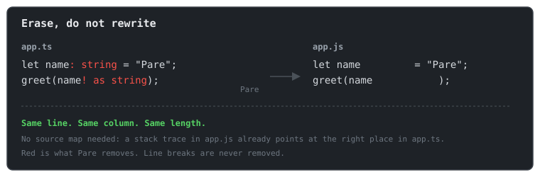

# Pare documentation

Pare turns TypeScript into JavaScript by erasing the types. That is all it does. It is written in
C#, ships as one native binary, and needs no Node, no npm and no source maps.

Here is a file before and after:

```ts
function add(a: number, b: number): number {
  return a + b;
}
```

```js
function add(a        , b        )         {
  return a + b;
}
```

The types became spaces. Every other character is still on the same line and column it started
on. When the browser says `app.js:2:10`, that is `app.ts:2:10`.



## Who it is for

- **ASP.NET Core developers** who want to write TypeScript in `wwwroot` without installing Node.
  Add one package and `dotnet build` does the rest.
- **Anyone with a static site** who wants a single binary that turns `src/*.ts` into `js/*.js`.
- **Tool authors** who want to strip types from C#, or from Rust, Go, Python and others through a
  C library.

## Who it is not for

Pare does not type check, bundle, minify or compile JSX. If you need those, use `tsc`, esbuild or
Vite. Pare also refuses TypeScript that needs generated code, such as `enum`. It tells you what
to write instead. See [What Pare does not do](what-pare-does-not-do.md).

## Where to go next

| You want to | Read |
|---|---|
| Try it in five minutes | [Getting started](../01-getting-started/README.md) |
| Add it to an ASP.NET Core app | [Your first web app](../01-getting-started/first-web-app.md) |
| Use it without .NET | [Your first static site](../01-getting-started/first-static-site.md) |
| Understand how it works | [How Pare works](how-it-works.md) |
| See how it compares to esbuild, Node and the rest | [Pare and the alternatives](comparison.md) |
| Look up an error | [Error codes](../06-reference/error-codes.md) |
| Look up a setting | [MSBuild properties](../06-reference/msbuild-properties.md) |
