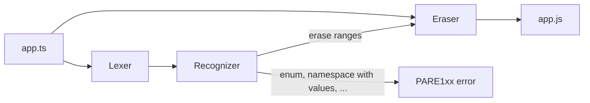
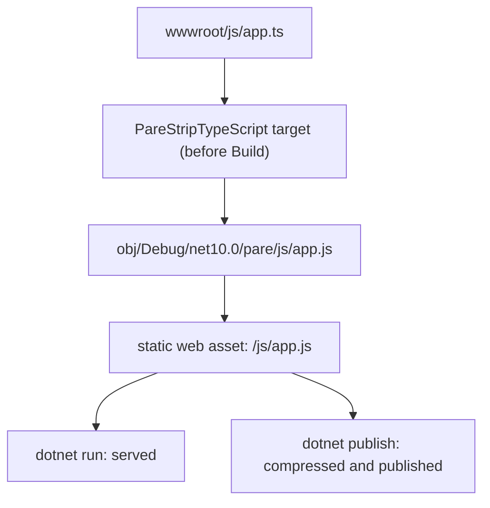

# How Pare works

Pare reads your TypeScript once, finds the parts that are only types, and writes the same text
back with those parts replaced by spaces. It never builds a syntax tree and never prints code, so
nothing it does not understand can be reformatted or lost.

1. **The lexer** splits the text into tokens: names, numbers, strings, template literals,
   regular expressions, comments.
2. **The recognizer** walks the tokens with TypeScript's own grammar rules (it follows
   `parser.ts`) and records which ranges are types. It writes down a list of ranges, not a tree.
3. **The eraser** copies the source to the output, writing a space for every character in those
   ranges. Line breaks inside an erased range are kept, so line numbers never change.

If the recognizer meets syntax that cannot be erased, such as `enum`, the file is rejected with
an error that names the line and what to write instead.

## What "erase" means

| You write | Pare writes |
|---|---|
| `let x: number = 1;` | `let x         = 1;` |
| `function f<T>(a: T): T {}` | `function f   (a   )    {}` |
| `value as string` | `value          ` |
| `interface A { x: number }` | (spaces, the line breaks stay) |
| `import type { A } from "m";` | (spaces) |
| `import { type A, b } from "m";` | `import {         b } from "m";` |

The full list is in [Supported syntax](../06-reference/supported-syntax.md).

## A few things are not whitespace

In a handful of cases erasing alone would change what the program means, so Pare adds a character
or edits an import:

- `import "./util.ts"` becomes `import "./util.js"` in the CLI and in the MSBuild package.
- A line that begins with `(` or `[` after an erased statement gets a `;` so it does not glue
  onto the line above.

[Output changes](../06-reference/output-changes.md) lists every case.

## Why it is fast

The lexer and recognizer work on spans of the original text and write erase ranges into a
buffer that is reused. While Pare parses it allocates nothing: no tokens, no strings, no tree.
On `checker.ts` from the TypeScript repository (3.1 MB) it takes about 9 ms, around 335 MB/s.
See [Benchmarks](../06-reference/benchmarks.md).

## Where the pieces live

| Package | What it is |
|---|---|
| `Extrode.Pare` | the library: `TypeStripper.Strip`. No dependencies. |
| `Extrode.Pare.Cli` | the `pare` command line tool, NativeAOT |
| `Extrode.Pare.Build` | an MSBuild task and targets that strip `.ts` during `dotnet build` |
| `Extrode.Pare.AspNetCore` | `AddPareDevelopment()`: re-strips on save under `dotnet watch` |
| `libpare` | the same stripper as a C shared library, for other languages |

## Inside a .NET build

The output lives under `obj/`, never in your source tree, so there is nothing to put in
`.gitignore`. The build keeps the `.ts` out of the published site and deletes the output of a
`.ts` you delete.
