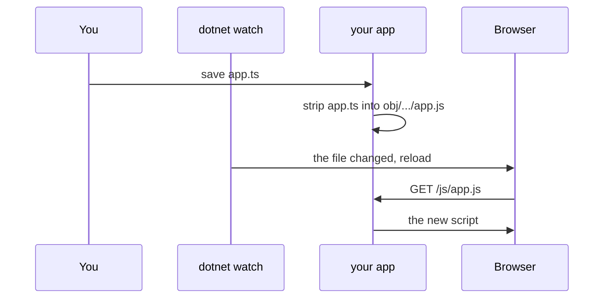

# Hot reload

`dotnet watch` reloads the browser when a file changes. For C# that works out of the box. For
`.ts` it needs one line, because in its default hot reload mode `dotnet watch` runs no build when
a `.ts` file is saved, so the `.js` would go stale.

## Turn it on

```xml
<PackageReference Include="Extrode.Pare.AspNetCore" Version="0.6.1" />
```

```csharp
builder.AddPareDevelopment();   // before builder.Build(); does nothing outside Development
```

Now this happens on every save:



- At start-up the app strips every source that is out of date.
- It reads `Extrode.Pare.development.json`, which the build puts next to the app and never
  publishes, to know where each source's output goes.
- A rejected file is logged as `file:line:col: error PARE...` and the old `.js` stays.
- Deleting a source deletes its output under `obj/`.
- It covers sources served with `PareServeAt` and sources of a Razor class library that the app
  references as a project.

If you set `PareOutDir`, pass the same folder: `builder.AddPareDevelopment(o => o.OutDir = "...")`.

`AddPareDevelopment` also adds `dotnet watch`'s browser refresh to `WebApplication.CreateSlimBuilder`
apps, which never run the hosting startup that adds it.

## Limits

- A `.ts` file **added** while `dotnet watch` runs is stripped, but the page gets 404 for it until
  the next build. Press Ctrl+R in `dotnet watch` to rebuild. The log says so.
- A request for a deleted source's output answers 500 in Development until the next build.
- In Development the server still serves `.ts` source files on disk with a warning.
  `MapStaticAssets` serves any file on disk in Development, and `UseStaticFiles` serves everything
  under `wwwroot`. Published output never contains them.

## If it does not reload

- **`PublishAot` project:** add
  `<StartupHookSupport Condition="'$(Configuration)' == 'Debug'">true</StartupHookSupport>`.
  Without it `dotnet watch` says "Project does not support Hot Reload".
- **Run `dotnet watch` from the project directory.** With `--project` from another folder, .NET SDK
  10.0.401 on macOS fails to read `obj\Debug/.../staticwebassets.development.json` and never
  refreshes the page.
- **No package?** `dotnet watch --no-hot-reload` rebuilds and restarts on every save (about 3
  seconds on the sample) and you reload the page yourself.
